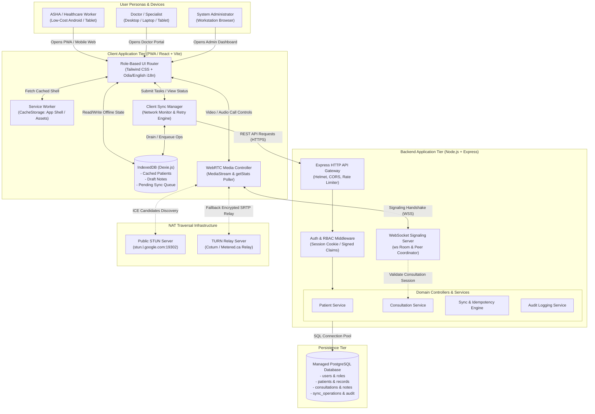
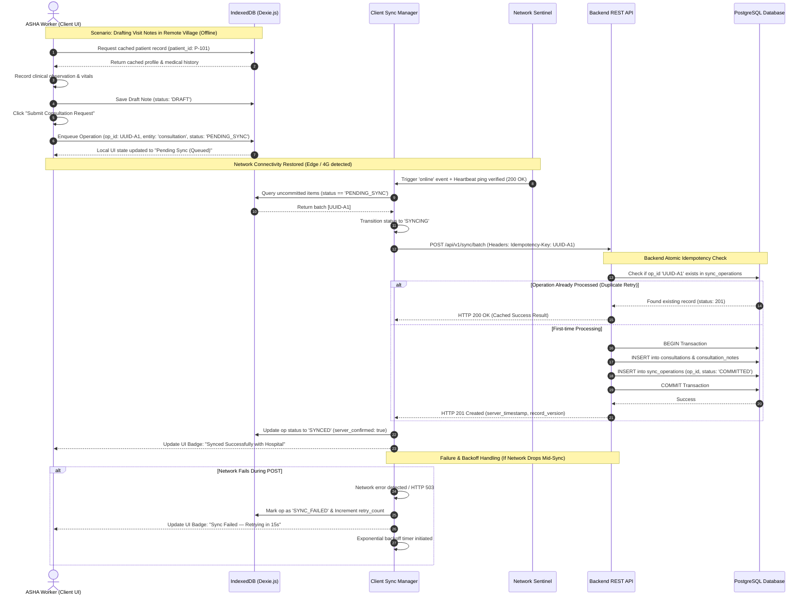
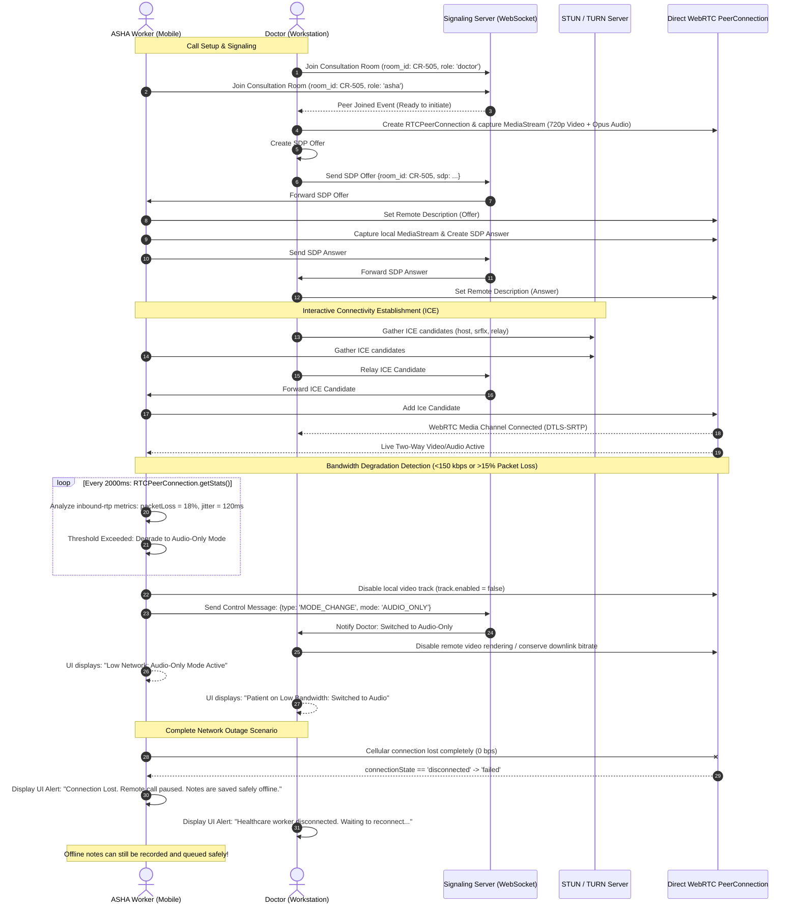
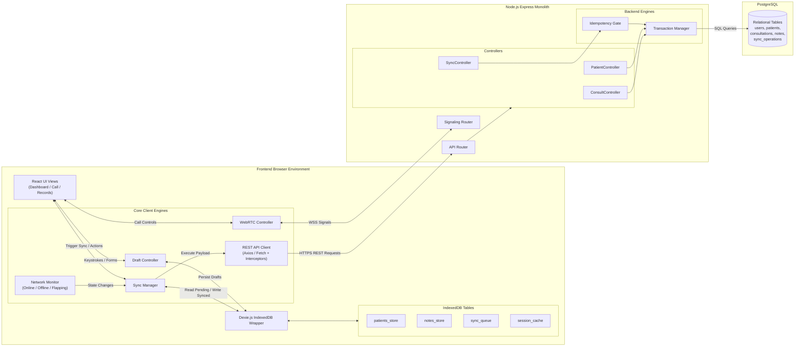

# Swasthya Setu — System Architecture Diagrams

**Document:** `architecture/architecture-diagram.md`  
**Project:** Swasthya Setu — Low-Network Telemedicine  
**Track:** Innovate Odisha 3.0  
**Role:** Senior Software Architect & Healthcare Technology Engineer  
**Status:** Approved Architectural Blueprint  
**Version:** 1.0  

---

This document presents the visual architecture of Swasthya Setu using GitHub-compatible **Mermaid** diagrams. The diagrams decompose the system into distinct, focused representations: High-Level System Architecture, Offline-First Data Flow, Telemedicine Consultation Flow, Authentication and Role-Based Access, and Component Interactions.

---

## Diagram 1: High-Level System Architecture

This diagram details the top-level structural layout, user boundaries, client storage, service worker, backend gateway, signaling service, database, and NAT traversal components.



---

## Diagram 2: Offline-First Data Flow

This diagram illustrates how patient records are read offline, drafts are saved locally, queued operations are buffered during network outages, and safe synchronization occurs upon reconnection with idempotency checks and conflict safeguards.



---

## Diagram 3: Telemedicine Consultation Flow (Adaptive WebRTC)

This diagram outlines how a consultation room is initialized, how WebRTC peer connection is negotiated via WebSocket signaling, how media telemetry adapts from video to audio, and the explicit boundary when connectivity fails completely.



---

## Diagram 4: Authentication and Role-Based Access Control (RBAC)

This diagram details the authentication handshake, credential validation, cryptographic cookie issuance, and backend authorization filters across distinct roles.

```mermaid
flowchart TD
    subgraph Client ["Client Device"]
        LOGIN_FORM["User Enters Credentials<br/>(Username / Password)"]
        CLIENT_CTX["Client Auth Context<br/>(Stores non-sensitive user profile in memory)"]
        PROT_ROUTE["Protected Route Guard<br/>(Checks in-memory role for UI view)"]
    end

    subgraph BackendAuth ["Backend Authentication & RBAC Gate"]
        AUTH_EP["POST /api/v1/auth/login"]
        BCRYPT["Password Hash Verifier<br/>(bcrypt.compare)"]
        COOKIE_GEN["Session Token Generator<br/>(Cryptographically Signed Session / JWT)"]
        AUTH_MW["Express Middleware: authenticateUser"]
        RBAC_MW["Express Middleware: requireRole(...)"]
    end

    subgraph Database ["PostgreSQL Auth Store"]
        USERS_TBL[("Table: users<br/>id, username, password_hash,<br/>role, is_active, facility_id")]
        AUDIT_TBL[("Table: audit_events<br/>actor_id, action, ip, timestamp")]
    end

    LOGIN_FORM -->|"POST Credentials (HTTPS)"| AUTH_EP
    AUTH_EP -->|"Query User by Username"| USERS_TBL
    USERS_TBL -->>|"Return User Record & Hash"| AUTH_EP
    AUTH_EP --> BCRYPT
    
    BCRYPT -->>|"Invalid Password"| FAIL_RESP["Return 401 Unauthorized<br/>Log Failed Attempt"]
    FAIL_RESP --> AUDIT_TBL
    
    BCRYPT -->>|"Password Valid"| COOKIE_GEN
    COOKIE_GEN -->|"Set-Cookie: session_token<br/>HttpOnly; Secure; SameSite=Strict"| CLIENT_CTX
    COOKIE_GEN -->|"Log Successful Login"| AUDIT_TBL
    
    CLIENT_CTX --> PROT_ROUTE

    %% API Request Authorization Flow
    subgraph APIExecution ["Protected API Endpoint Execution"]
        API_REQ["Client Makes Data Request<br/>(GET /api/v1/patients/:id)"]
        ROLE_CHECK{"Does user role match<br/>required permissions?"}
        DATA_EXEC["Execute Domain Logic & Return Data"]
        FORBIDDEN["Return 403 Forbidden"]
    end

    PROT_ROUTE -.->|"Includes Session Cookie"| API_REQ
    API_REQ --> AUTH_MW
    AUTH_MW -->|"Validate Signature & Extract Role"| RBAC_MW
    RBAC_MW --> ROLE_CHECK
    ROLE_CHECK -->>|"Yes: ASHA or Doctor"| DATA_EXEC
    ROLE_CHECK -->>|"No: Role Mismatch"| FORBIDDEN
```

---

## Diagram 5: Component Interaction Diagram

This diagram displays the internal boundaries and relationships between client components, local persistence, network monitors, backend controllers, and database models.



---

## Diagram Syntax & Compatibility Verification

* All diagrams conform to standard **Mermaid v10+** syntax.
* Node identifiers are alphanumeric with underscores; all text strings containing parentheses, brackets, or slashes are quoted inside standard Mermaid shapes (`["..."]` and `("...")`).
* Fenced blocks use the lowercase `mermaid` identifier, ensuring seamless rendering across GitHub, GitLab, and Markdown previewers.
