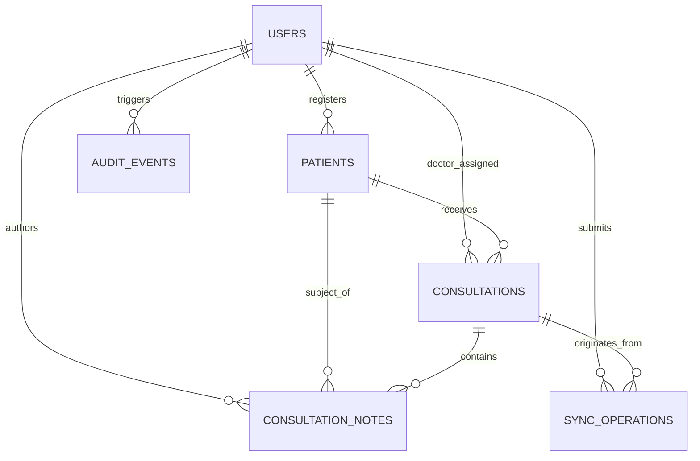

# Swasthya Setu — Relational Database & Client Storage Design

**Document:** `architecture/database-design.md`  
**Project:** Swasthya Setu — Low-Network Telemedicine  
**Track:** Innovate Odisha 3.0  
**Role:** Senior Software Architect & Healthcare Technology Engineer  
**Status:** Approved Architectural Blueprint  
**Version:** 1.0  

---

This document defines the data architecture for Swasthya Setu. It provides the complete relational schema for the server-side **PostgreSQL** database and the client-side **IndexedDB** object stores (via Dexie.js), detailing types, primary keys, foreign keys, constraints, and indexes. It also articulates the boundary between authoritative server storage and temporary client-side caching.

---

## 1. Design Principles & Data Minimization

1. **Synthetic Data Policy:** For hackathon development and public demonstration, all patient records must contain strictly synthetic, non-identifiable sample data.
2. **Canonical UUIDs:** Primary keys for domain entities (`patients`, `consultations`, `consultation_notes`, `sync_operations`) use **UUIDv4** (`gen_random_uuid()` in PostgreSQL or `crypto.randomUUID()` on the client). This allows clients to generate valid relational identifiers while disconnected without risking primary key collisions upon server ingestion.
3. **Append-Only Clinical Audit:** Clinical notes are immutable. Updates generate a new version record referencing the parent note. Notes are never deleted (`soft_deleted_at` used if required).
4. **Idempotency Gate:** The `sync_operations` table acts as a transactional idempotency barrier, storing client operation UUIDs to prevent replay attacks and duplicate submissions.
5. **Data Minimization:** Only data necessary for direct clinical care and triage (demographics, vital signs, allergies, consultation notes) is captured. Unnecessary personal identifiers (national ID numbers, financial data) are excluded from the MVP.

---

## 2. Server-Side Relational Schema (PostgreSQL)



---

### 2.1 Table: `users`
Stores system actors: Healthcare Workers (ASHA), Doctors, and Administrators.

| Column Name | Data Type | Modifiers | Description |
| :--- | :--- | :--- | :--- |
| `id` | `UUID` | `PRIMARY KEY DEFAULT gen_random_uuid()` | Unique user identifier. |
| `username` | `VARCHAR(50)` | `NOT NULL UNIQUE` | Unique login username. |
| `password_hash` | `VARCHAR(255)` | `NOT NULL` | bcrypt-hashed password string. |
| `full_name` | `VARCHAR(100)` | `NOT NULL` | Full legal or display name. |
| `role` | `VARCHAR(20)` | `NOT NULL CHECK (role IN ('ASHA', 'DOCTOR', 'ADMIN'))` | Role-based access control tier. |
| `phone_number` | `VARCHAR(20)` | `NULL` | Optional contact phone number. |
| `facility_name` | `VARCHAR(100)` | `NOT NULL` | PHC, CHC, or village health sub-center name. |
| `preferred_language` | `VARCHAR(5)` | `NOT NULL DEFAULT 'or' CHECK (preferred_language IN ('or', 'en'))` | UI language preference (Odia / English). |
| `is_active` | `BOOLEAN` | `NOT NULL DEFAULT TRUE` | Account activation flag. |
| `created_at` | `TIMESTAMPTZ` | `NOT NULL DEFAULT NOW()` | Record creation timestamp. |
| `updated_at` | `TIMESTAMPTZ` | `NOT NULL DEFAULT NOW()` | Timestamp of last modification. |

* **Important Indexes:**
  - `CREATE UNIQUE INDEX idx_users_username ON users(username);`
  - `CREATE INDEX idx_users_role_active ON users(role, is_active);`

---

### 2.2 Table: `patients`
Stores synthetic patient demographic profiles and essential baseline health indicators.

| Column Name | Data Type | Modifiers | Description |
| :--- | :--- | :--- | :--- |
| `id` | `UUID` | `PRIMARY KEY DEFAULT gen_random_uuid()` | Canonical patient identifier. |
| `patient_code` | `VARCHAR(20)` | `NOT NULL UNIQUE` | Human-readable ID (e.g., `OD-P-10042`). |
| `full_name` | `VARCHAR(100)` | `NOT NULL` | Synthetic patient full name. |
| `date_of_birth` | `DATE` | `NULL` | Date of birth for age calculation. |
| `age_years` | `INTEGER` | `NOT NULL CHECK (age_years >= 0 AND age_years <= 130)` | Age in years (useful for rural triage). |
| `gender` | `VARCHAR(10)` | `NOT NULL CHECK (gender IN ('FEMALE', 'MALE', 'OTHER'))` | Biological sex or gender. |
| `village_name` | `VARCHAR(100)` | `NOT NULL` | Village or habitation location. |
| `contact_phone` | `VARCHAR(20)` | `NULL` | Patient or guardian contact number. |
| `blood_group` | `VARCHAR(5)` | `NULL CHECK (blood_group IN ('A+', 'A-', 'B+', 'B-', 'AB+', 'AB-', 'O+', 'O-', 'UNKNOWN'))` | Blood group indicator. |
| `known_allergies` | `TEXT[]` | `NOT NULL DEFAULT '{}'` | Known drug or substance allergies. |
| `chronic_conditions`| `TEXT[]` | `NOT NULL DEFAULT '{}'` | Diagnosed conditions (e.g., Hypertension, Diabetes). |
| `registered_by` | `UUID` | `NOT NULL REFERENCES users(id)` | Foreign key to ASHA worker who registered. |
| `created_at` | `TIMESTAMPTZ` | `NOT NULL DEFAULT NOW()` | Registration timestamp. |
| `updated_at` | `TIMESTAMPTZ` | `NOT NULL DEFAULT NOW()` | Last update timestamp. |

* **Important Indexes:**
  - `CREATE UNIQUE INDEX idx_patients_code ON patients(patient_code);`
  - `CREATE INDEX idx_patients_village ON patients(village_name);`
  - `CREATE INDEX idx_patients_registered_by ON patients(registered_by);`

---

### 2.3 Table: `consultations`
Tracks telemedicine consultation cases, scheduling, doctor assignments, and lifecycle states.

| Column Name | Data Type | Modifiers | Description |
| :--- | :--- | :--- | :--- |
| `id` | `UUID` | `PRIMARY KEY DEFAULT gen_random_uuid()` | Canonical consultation ID. |
| `patient_id` | `UUID` | `NOT NULL REFERENCES patients(id) ON DELETE RESTRICT` | Associated patient record. |
| `requested_by` | `UUID` | `NOT NULL REFERENCES users(id)` | ASHA worker who initiated request. |
| `assigned_doctor_id`| `UUID` | `NULL REFERENCES users(id)` | Doctor assigned to review/conduct call. |
| `priority` | `VARCHAR(10)` | `NOT NULL DEFAULT 'NORMAL' CHECK (priority IN ('ROUTINE', 'NORMAL', 'URGENT'))` | Clinical triage urgency level. |
| `status` | `VARCHAR(20)` | `NOT NULL DEFAULT 'REQUESTED' CHECK (status IN ('DRAFT', 'REQUESTED', 'ACCEPTED', 'IN_PROGRESS', 'INTERRUPTED', 'COMPLETED', 'CANCELLED'))` | Current lifecycle state. |
| `chief_complaint` | `TEXT` | `NOT NULL` | Primary symptoms reported by patient. |
| `call_started_at` | `TIMESTAMPTZ` | `NULL` | Timestamp WebRTC call began. |
| `call_ended_at` | `TIMESTAMPTZ` | `NULL` | Timestamp WebRTC call ended. |
| `media_mode` | `VARCHAR(15)` | `NOT NULL DEFAULT 'VIDEO' CHECK (media_mode IN ('VIDEO', 'AUDIO_ONLY', 'NONE'))` | Actual mode used during consultation. |
| `created_at` | `TIMESTAMPTZ` | `NOT NULL DEFAULT NOW()` | Request timestamp. |
| `updated_at` | `TIMESTAMPTZ` | `NOT NULL DEFAULT NOW()` | Last modification timestamp. |

* **Important Indexes:**
  - `CREATE INDEX idx_consultations_patient ON consultations(patient_id);`
  - `CREATE INDEX idx_consultations_doctor_status ON consultations(assigned_doctor_id, status);`
  - `CREATE INDEX idx_consultations_status ON consultations(status);`

---

### 2.4 Table: `consultation_notes`
Stores append-only clinical observations, vitals, provisional diagnoses, prescriptions, and referral instructions.

| Column Name | Data Type | Modifiers | Description |
| :--- | :--- | :--- | :--- |
| `id` | `UUID` | `PRIMARY KEY DEFAULT gen_random_uuid()` | Canonical note ID. |
| `consultation_id` | `UUID` | `NOT NULL REFERENCES consultations(id) ON DELETE CASCADE` | Associated consultation. |
| `patient_id` | `UUID` | `NOT NULL REFERENCES patients(id)` | De-normalized patient reference for fast queries. |
| `author_id` | `UUID` | `NOT NULL REFERENCES users(id)` | Healthcare worker or Doctor author. |
| `author_role` | `VARCHAR(20)` | `NOT NULL CHECK (author_role IN ('ASHA', 'DOCTOR'))` | Role of author at time of writing. |
| `vitals` | `JSONB` | `NOT NULL DEFAULT '{}'` | Structured vitals (`{ bp, pulse, spo2, temp_f, resp_rate }`). |
| `clinical_observations`| `TEXT` | `NOT NULL` | Descriptive symptoms and physical findings. |
| `diagnosis_summary` | `TEXT` | `NULL` | Doctor's provisional diagnosis or clinical impression. |
| `prescription` | `JSONB` | `NOT NULL DEFAULT '[]'` | Array of medications (`[{ drug, dosage, duration, instructions }]`). |
| `referral_facility` | `VARCHAR(100)` | `NULL` | CHC / District hospital name if referred. |
| `follow_up_date` | `DATE` | `NULL` | Advised date for next review. |
| `version` | `INTEGER` | `NOT NULL DEFAULT 1` | Note version counter for conflicts. |
| `created_at` | `TIMESTAMPTZ` | `NOT NULL DEFAULT NOW()` | Creation timestamp. |

* **Important Indexes:**
  - `CREATE INDEX idx_notes_consultation ON consultation_notes(consultation_id);`
  - `CREATE INDEX idx_notes_patient ON consultation_notes(patient_id);`

---

### 2.5 Table: `sync_operations`
Ensures idempotent request handling, audit tracking of client sync requests, and duplicate prevention.

| Column Name | Data Type | Modifiers | Description |
| :--- | :--- | :--- | :--- |
| `operation_id` | `UUID` | `PRIMARY KEY` | Client-generated unique operation UUID. |
| `user_id` | `UUID` | `NOT NULL REFERENCES users(id)` | Submitting authenticated user. |
| `entity_type` | `VARCHAR(30)` | `NOT NULL CHECK (entity_type IN ('PATIENT', 'CONSULTATION', 'CONSULTATION_NOTE', 'MESSAGE'))` | Type of synchronized domain entity. |
| `action` | `VARCHAR(10)` | `NOT NULL CHECK (action IN ('CREATE', 'UPDATE', 'STATUS_CHANGE'))` | Action performed. |
| `status` | `VARCHAR(20)` | `NOT NULL DEFAULT 'COMMITTED' CHECK (status IN ('COMMITTED', 'REJECTED', 'CONFLICT'))` | Processing outcome. |
| `request_payload` | `JSONB` | `NOT NULL` | Raw client request payload for audit. |
| `response_payload`| `JSONB` | `NOT NULL` | Response returned to client for replaying. |
| `created_at` | `TIMESTAMPTZ` | `NOT NULL DEFAULT NOW()` | Timestamp processed by server. |

* **Important Indexes:**
  - `CREATE UNIQUE INDEX idx_sync_op_id ON sync_operations(operation_id);`
  - `CREATE INDEX idx_sync_user_created ON sync_operations(user_id, created_at DESC);`

---

### 2.6 Table: `audit_events`
Immutable security and clinical access audit log.

| Column Name | Data Type | Modifiers | Description |
| :--- | :--- | :--- | :--- |
| `id` | `UUID` | `PRIMARY KEY DEFAULT gen_random_uuid()` | Audit record identifier. |
| `actor_id` | `UUID` | `NULL REFERENCES users(id)` | User performing action (NULL if unauth attempt). |
| `action` | `VARCHAR(50)` | `NOT NULL` | Action code (e.g., `LOGIN_SUCCESS`, `RECORD_READ`, `SYNC_SUBMIT`). |
| `resource_type` | `VARCHAR(30)` | `NOT NULL` | Entity type accessed (e.g., `PATIENT`, `AUTH`). |
| `resource_id` | `VARCHAR(50)` | `NULL` | ID of accessed resource. |
| `ip_address` | `VARCHAR(45)` | `NULL` | Client IP address. |
| `user_agent` | `TEXT` | `NULL` | Browser user-agent header. |
| `details` | `JSONB` | `NOT NULL DEFAULT '{}'` | Non-sensitive contextual metadata. |
| `created_at` | `TIMESTAMPTZ` | `NOT NULL DEFAULT NOW()` | Event occurrence timestamp. |

* **Important Indexes:**
  - `CREATE INDEX idx_audit_actor ON audit_events(actor_id);`
  - `CREATE INDEX idx_audit_created ON audit_events(created_at DESC);`

---

## 3. Client-Side Offline Schema (IndexedDB via Dexie.js)

The client database is named `SwasthyaSetuDB`. It contains four dedicated object stores optimized for offline query performance and synchronization management.

### Dexie Schema Definition (`src/db/index.ts`)
```typescript
import Dexie, { Table } from 'dexie';

export interface LocalPatient {
  id: string; // UUIDv4
  patient_code: string;
  full_name: string;
  age_years: number;
  gender: 'FEMALE' | 'MALE' | 'OTHER';
  village_name: string;
  contact_phone?: string;
  blood_group?: string;
  known_allergies: string[];
  chronic_conditions: string[];
  cached_at: string; // ISO8601 string
}

export interface LocalConsultationNote {
  note_id: string; // UUIDv4
  consultation_id: string;
  patient_id: string;
  author_id: string;
  author_role: 'ASHA' | 'DOCTOR';
  vitals: {
    bp?: string;
    pulse?: number;
    spo2?: number;
    temp_f?: number;
    resp_rate?: number;
  };
  clinical_observations: string;
  diagnosis_summary?: string;
  prescription: Array<{
    drug: string;
    dosage: string;
    duration: string;
    instructions: string;
  }>;
  referral_facility?: string;
  follow_up_date?: string;
  status: 'DRAFT' | 'PENDING_SYNC' | 'SYNCED' | 'CONFLICT';
  updated_at: string;
}

export interface LocalSyncQueueItem {
  operation_id: string; // UUIDv4 (Idempotency Key)
  entity_type: 'PATIENT' | 'CONSULTATION' | 'CONSULTATION_NOTE' | 'MESSAGE';
  action: 'CREATE' | 'UPDATE' | 'STATUS_CHANGE';
  payload: Record<string, any>;
  status: 'PENDING_SYNC' | 'SYNCING' | 'SYNCED' | 'SYNC_FAILED' | 'CONFLICT';
  retry_count: number;
  last_error?: string;
  created_at: string;
}

export interface LocalSessionCache {
  key: string; // 'current_session'
  user_id: string;
  username: string;
  full_name: string;
  role: 'ASHA' | 'DOCTOR' | 'ADMIN';
  facility_name: string;
  expires_at: string;
}

export class SwasthyaSetuDB extends Dexie {
  patients!: Table<LocalPatient, string>;
  notes!: Table<LocalConsultationNote, string>;
  sync_queue!: Table<LocalSyncQueueItem, string>;
  session!: Table<LocalSessionCache, string>;

  constructor() {
    super('SwasthyaSetuDB');
    this.version(1).stores({
      patients: 'id, patient_code, village_name, cached_at',
      notes: 'note_id, consultation_id, patient_id, status, updated_at',
      sync_queue: 'operation_id, status, entity_type, created_at, retry_count',
      session: 'key'
    });
  }
}

export const db = new SwasthyaSetuDB();
```

---

## 4. Authoritative Server Storage vs. Temporary Client Cache

| Dimension | PostgreSQL (Server-Side) | IndexedDB (Client-Side) |
| :--- | :--- | :--- |
| **Authority** | **Authoritative Source of Truth:** Contains the finalized medical history, active user accounts, and confirmed audit trails. | **Optimistic / Working Cache:** Contains only working drafts, local sync buffers, and records explicitly selected for offline field use. |
| **Lifespan** | **Permanent & Persistent:** Backed by managed daily snapshots, transaction logs, and disaster recovery. | **Transient & Disposable:** Can be purged on user logout, browser quota eviction, or explicit "Clear Local Cache" command. |
| **Scope** | Complete system data across all facilities and providers subject to RBAC. | Scoped strictly to the logged-in healthcare worker's assigned patients and current visit drafts. |
| **Integrity Checks** | Enforced via strict SQL foreign keys, unique indexes, and ACID transaction boundaries. | Enforced via TypeScript types and Dexie schema indexes; lacks relational cascading foreign keys. |
| **Confidentiality Risk** | Protected by VPC network isolation, SSL/TLS, and strict database user permissions. | Resides on physical client device (e.g., tablet). Protected by origin isolation and session purge protocols. |

---

## 5. Migration and Seeding Strategy

* **Migrations:** Managed via SQL schema scripts (`migrations/001_initial_schema.sql`) executed during backend initialization.
* **Synthetic Seed Data:** A seed script (`scripts/seed_synthetic_data.ts`) populates:
  - 3 User accounts: `asha_sunita` (ASHA), `dr_patnaik` (Doctor), `admin_odisha` (Admin) with known test credentials.
  - 10 Realistic Synthetic Patients representing common rural Odisha health scenarios (e.g., antenatal checkup, seasonal malaria, chronic hypertension).
  - 5 Historical consultations with realistic Odia/English notes.
