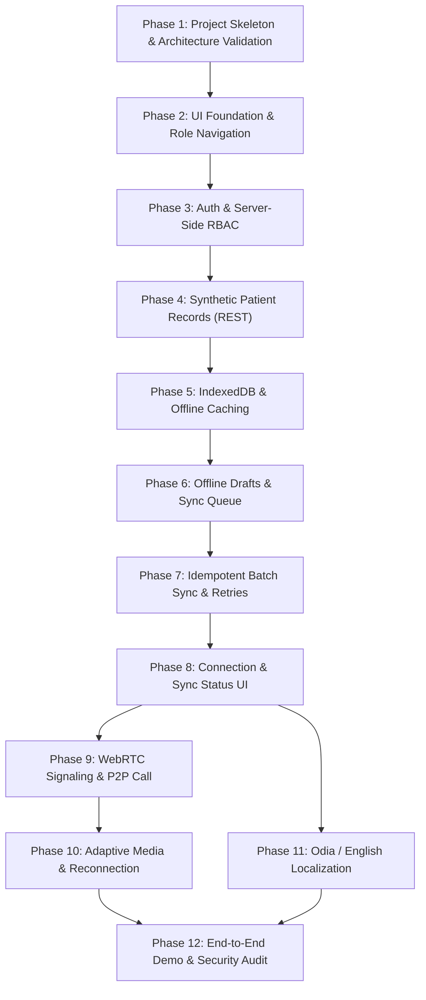

# Swasthya Setu — Implementation Roadmap & Test Plan

**Document:** `architecture/implementation-roadmap.md`  
**Project:** Swasthya Setu — Low-Network Telemedicine  
**Track:** Innovate Odisha 3.0  
**Role:** Senior Software Architect & Healthcare Technology Engineer  
**Status:** Approved Architectural Blueprint  
**Version:** 1.0  

---

This roadmap organizes the development of Swasthya Setu into **12 testable, sequential phases**. Each phase specifies clear objectives, concrete tasks, dependencies, concrete deliverables, acceptance criteria, required tests, and a specific demonstration target for hackathon judges.

---

## Phase Overview & Dependency Graph

---

## Phase-by-Phase Execution Plan

### Phase 1: Project Setup, Structure & Architecture Validation
* **Objective:** Establish the unified TypeScript monorepo/workspace, configure development environments, and validate architectural guidelines.
* **Tasks:**
  1. Initialize React + Vite frontend with TypeScript and Tailwind CSS.
  2. Initialize Node.js + Express backend with TypeScript, ts-node-dev, and CORS/Helmet.
  3. Configure ESLint, Prettier, and environment variable loaders (`.env`).
  4. Setup PostgreSQL database connection pool (`pg` / `kysely` / `knex`).
* **Dependencies:** None.
* **Deliverables:** Working dual-engine dev environment (`npm run dev` starts frontend on `:5173` and backend on `:5000`).
* **Acceptance Criteria:** Frontend displays hello page; backend returns `{ status: "ok" }` on `/api/v1/health`.
* **Tests Required:** Smoke tests verifying HTTP 200 on health endpoint.
* **Judges Demo Target:** Clean build and running developer console.

---

### Phase 2: UI Foundation & Role-Based Navigation
* **Objective:** Build responsive, mobile-first layouts for ASHA Worker, Doctor, and Administrator views.
* **Tasks:**
  1. Create mobile-first App Shell with responsive header, navigation drawer, and bottom navigation.
  2. Implement placeholder views: ASHA Dashboard, Doctor Dashboard, Admin Panel.
  3. Setup React Router with layout wrappers.
* **Dependencies:** Phase 1.
* **Deliverables:** Navigable frontend shell with distinct visual themes for ASHA (mobile-centric) and Doctor (clinical workstation).
* **Acceptance Criteria:** Application renders cleanly on simulated mobile viewport (360x640) and desktop viewport (1440x900).
* **Tests Required:** Responsive layout visual regression check in Chrome DevTools mobile emulator.
* **Judges Demo Target:** Switching between role dashboard mockups on a mobile viewport.

---

### Phase 3: Authentication & Server-Side Permissions (RBAC)
* **Objective:** Implement secure login, session-based cookie issuance, and backend role enforcement.
* **Tasks:**
  1. Implement `users` table migration and seed accounts (`asha_sunita`, `dr_patnaik`, `admin_odisha`).
  2. Create `POST /api/v1/auth/login`, `GET /api/v1/auth/me`, and `POST /api/v1/auth/logout`.
  3. Implement `authenticateUser` and `requireRole` Express middlewares.
  4. Create client auth context storing user metadata.
* **Dependencies:** Phase 2.
* **Deliverables:** Secure authentication pipeline with `HttpOnly` cookies and role routing.
* **Acceptance Criteria:** ASHA credentials cannot access Admin routes (returns 403 Forbidden); invalid password returns 401.
* **Tests Required:** Unit tests for bcrypt hashing and integration tests verifying 401/403 HTTP status responses.
* **Judges Demo Target:** Logging in as ASHA worker, showing role badge, attempting to access doctor URL and being blocked by server.

---

### Phase 4: Patient Records Using Synthetic Data
* **Objective:** Implement REST APIs and database models for synthetic patient profiles.
* **Tasks:**
  1. Execute `patients` and `consultations` table migrations.
  2. Create synthetic data seeding script generating 10 realistic Odisha village health cases.
  3. Implement `GET /api/v1/patients`, `GET /api/v1/patients/:id`, and `POST /api/v1/patients`.
  4. Build patient list and clinical summary UI views.
* **Dependencies:** Phase 3.
* **Deliverables:** Working online patient registry with search and detail views.
* **Acceptance Criteria:** ASHA worker can search and view complete synthetic medical history online.
* **Tests Required:** Integration tests for patient filtering and schema validation (Zod).
* **Judges Demo Target:** Searching for synthetic patient "Gitanjali Majhi" and opening her medical history.

---

### Phase 5: IndexedDB & Offline Record Access
* **Objective:** Enable offline caching of explicitly selected patient records via Dexie.js and Service Worker.
* **Tasks:**
  1. Configure `vite-plugin-pwa` with Workbox caching for the App Shell.
  2. Define `SwasthyaSetuDB` in Dexie.js with `patients` store.
  3. Implement "Download for Offline Field Visit" action on patient profile.
  4. Intercept patient detail queries: read from IndexedDB first when offline.
* **Dependencies:** Phase 4.
* **Deliverables:** Offline-capable PWA that opens and renders downloaded patient records with zero internet connectivity.
* **Acceptance Criteria:** Turning off network in DevTools still allows opening previously downloaded records; uncached records show "Unavailable Offline" banner.
* **Tests Required:** DevTools Offline simulation test verifying record loads without network calls.
* **Judges Demo Target:** Disconnecting Wi-Fi completely, refreshing the page, and opening the cached patient record with a visible "Offline Mode" badge.

---

### Phase 6: Local Consultation Notes & Pending Sync Queue
* **Objective:** Enable offline drafting of clinical visit notes and enqueuing them locally.
* **Tasks:**
  1. Build Consultation Note Editor with vital signs, symptoms, and referral inputs.
  2. Implement debounced reactive autosave into Dexie `notes` store on every keystroke.
  3. Build `sync_queue` Dexie store and "Queue for Sync" submission flow.
  4. Assign client-side UUIDv4 (`operation_id`) to every queued action.
* **Dependencies:** Phase 5.
* **Deliverables:** Persistent offline note drafting where notes survive page refresh and browser tab closure.
* **Acceptance Criteria:** Drafting a note offline persists in IndexedDB with status `PENDING_SYNC`; refreshing page restores draft.
* **Tests Required:** Form persistence test across tab reload while offline.
* **Judges Demo Target:** Filling out a visit note while offline, closing the browser tab, reopening it, and proving the note is 100% preserved.

---

### Phase 7: Safe Synchronization, Idempotency & Retry Logic
* **Objective:** Implement backend batch sync ingestion with duplicate prevention and conflict handling.
* **Tasks:**
  1. Create `sync_operations` table in PostgreSQL.
  2. Implement `POST /api/v1/sync/batch` accepting array of operations.
  3. Implement backend idempotency gate: duplicate `operation_id` returns cached success without re-inserting.
  4. Implement Client Sync Manager with exponential backoff and jitter.
* **Dependencies:** Phase 6.
* **Deliverables:** Resilient synchronization pipeline that guarantees zero duplicates and zero lost updates.
* **Acceptance Criteria:** Submitting the same batch twice produces exactly one database row; server acknowledges with 200 OK.
* **Tests Required:** Automated test sending duplicate `operation_id` concurrently to verify idempotent deduplication.
* **Judges Demo Target:** Reconnecting network, showing queue drain, verifying single record in database, and retrying same payload to prove no duplicates.

---

### Phase 8: Connection Status & Sync Status UI
* **Objective:** Provide continuous, honest status indicators for network connectivity and synchronization states.
* **Tasks:**
  1. Implement Network Sentinel combining `navigator.onLine` and 15-second heartbeat to `/api/v1/health`.
  2. Create global UI Status Banner rendering states: *Connected*, *Offline (3 Queued)*, *Syncing...*, *Sync Failed*.
  3. Build dedicated "Sync Management Dashboard" with itemized queue inspection and manual retry button.
* **Dependencies:** Phase 7.
* **Deliverables:** Transparent, non-deceptive status UI across all screens.
* **Acceptance Criteria:** UI transitions immediately when network is toggled; pending items count updates reactively.
* **Tests Required:** Reactive state tests verifying UI badge updates within 500ms of queue mutations.
* **Judges Demo Target:** Showing the sync counter decrement in real-time as items are delivered to the server.

---

### Phase 9: WebRTC Signaling & Audio/Video Consultation
* **Objective:** Implement real-time 1-to-1 teleconsultation calling using WebRTC and WebSocket signaling.
* **Tasks:**
  1. Implement WebSocket signaling server (`ws`) on backend handling `JOIN_ROOM`, `OFFER`, `ANSWER`, and `ICE_CANDIDATE`.
  2. Implement client WebRTC controller managing `RTCPeerConnection` and local `MediaStream`.
  3. Configure STUN servers and public TURN relay credentials.
  4. Build Video Call UI with local and remote media viewports, mute, and end call controls.
* **Dependencies:** Phase 8.
* **Deliverables:** Functional two-way audio/video call between ASHA worker and doctor.
* **Acceptance Criteria:** Doctor and ASHA worker can establish an audio/video call across two separate browser windows.
* **Tests Required:** WebRTC peer connection state reaches `'connected'` over simulated NAT.
* **Judges Demo Target:** Initiating a live video consultation between doctor and healthcare worker screens.

---

### Phase 10: Adaptive Video-to-Audio Behavior & Reconnection
* **Objective:** Implement automated media throttling, audio-only fallback on poor networks, and ICE restart.
* **Tasks:**
  1. Build telemetry monitor polling `peerConnection.getStats()` every 2000ms.
  2. Trigger automated fallback when packet loss $> 15\%$ or RTT $> 600\text{ ms}$: disable video track and alert peer.
  3. Implement manual "Switch to Audio Mode" button.
  4. Implement ICE restart on connection disconnect with 30-second watchdog.
* **Dependencies:** Phase 9.
* **Deliverables:** Resilient WebRTC calling engine that gracefully degrades to audio under simulated packet loss.
* **Acceptance Criteria:** Throttling network in DevTools triggers audio fallback; UI alerts both peers; call persists.
* **Tests Required:** Simulated packet loss test triggering `MODE_CHANGE: AUDIO_ONLY`.
* **Judges Demo Target:** Simulating 20% packet loss in DevTools, showing automatic video shutdown, and demonstrating uninterrupted voice communication.

---

### Phase 11: Odia / English Interface & Essential Messaging
* **Objective:** Localize application workflows in Odia and English, and support queued offline text messages.
* **Tasks:**
  1. Create lightweight i18n dictionary system with Odia (`or`) and English (`en`) translations for all core screens.
  2. Add persistent language toggle in navigation header.
  3. Implement offline message queue in IndexedDB with status badges (*Pending*, *Sent*, *Delivered*).
* **Dependencies:** Phase 8.
* **Deliverables:** Fully bilingual user interface accessible in Odia for frontline ASHA workers.
* **Acceptance Criteria:** Switching to Odia translates all form labels, buttons, and status alerts immediately.
* **Tests Required:** Language persistence test across browser reloads.
* **Judges Demo Target:** Toggling UI to Odia, demonstrating field note creation in Odia, and showing queued message delivery.

---

### Phase 12: Security Verification, Network Tests & Demo Polish
* **Objective:** Perform end-to-end reliability verification, security audit, synthetic data validation, and rehearsal.
* **Tasks:**
  1. Verify zero unhandled exceptions on network drops.
  2. Verify all API routes reject unauthorized roles.
  3. Ensure no real patient data exists in database or seed scripts.
  4. Prepare end-to-end script for judges demonstration.
* **Dependencies:** Phases 1–11.
* **Deliverables:** Hardened, demonstration-ready platform with complete documentation.
* **Acceptance Criteria:** All test scenarios in `docs/feature.md` Section 9 pass.
* **Tests Required:** End-to-end offline-to-online recovery test script.
* **Judges Demo Target:** Complete 5-minute uninterrupted judge presentation showing full field visit, offline note creation, network reconnection, idempotent sync, and adaptive call.
