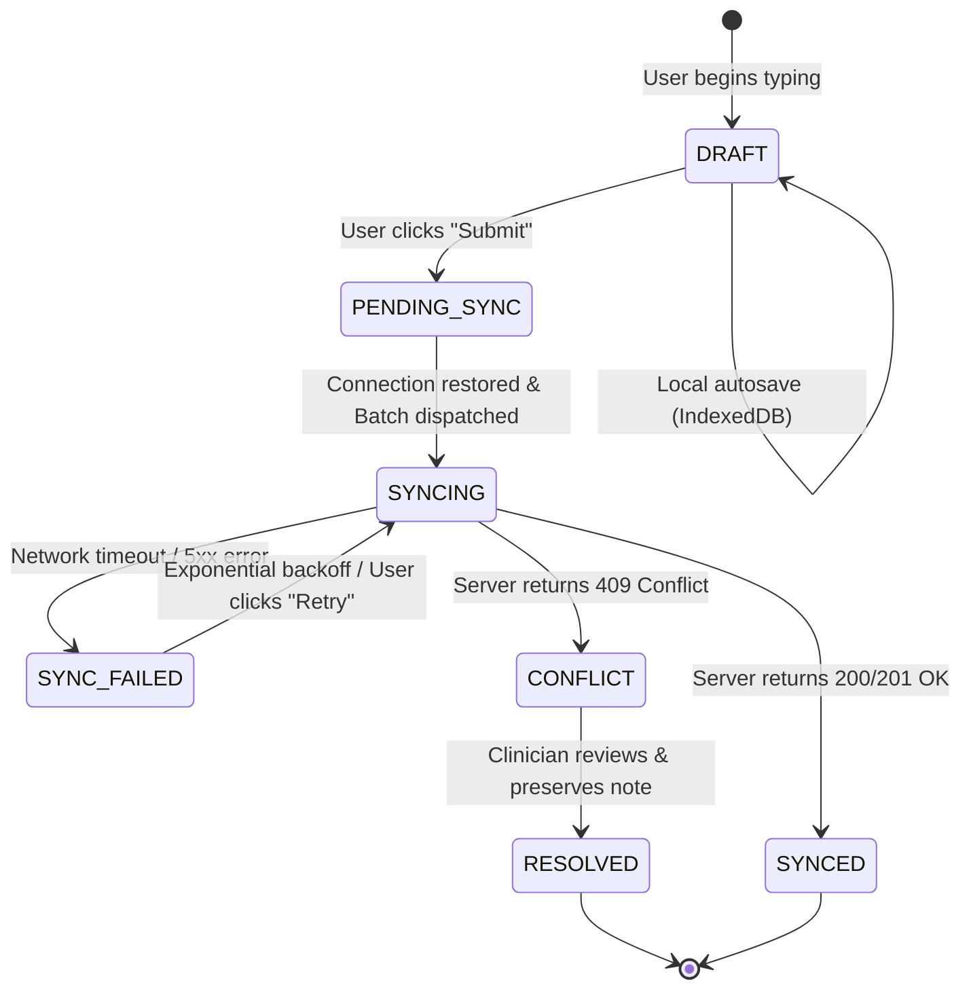

# Swasthya Setu — Offline-First Synchronization Architecture

**Document:** `architecture/offline-sync-design.md`  
**Project:** Swasthya Setu — Low-Network Telemedicine  
**Track:** Innovate Odisha 3.0  
**Role:** Senior Software Architect & Healthcare Technology Engineer  
**Status:** Approved Architectural Blueprint  
**Version:** 1.0  

---

This document defines the offline-first data synchronization engine for Swasthya Setu. Because intermittent and absent connectivity is the core constraint in rural healthcare delivery, this architecture treats offline operation as a primary operating mode, not an exceptional edge case.

---

## 1. Data Classification: Cacheable vs. Prohibited

To uphold patient privacy and conserve client device storage on low-cost hardware, client caching follows a strict data classification policy:

| Data Category | Permitted to Cache Offline? | Storage Location | Retention / Expiry Policy |
| :--- | :--- | :--- | :--- |
| **Application Shell (HTML/JS/CSS/i18n)** | **YES** | Service Worker `CacheStorage` | Replaced on new app version release. |
| **Assigned Synthetic Patient Summaries** | **YES** (Explicit Download) | IndexedDB `patients` store | Evicted on user logout or after 7 days without refresh. |
| **Clinical Consultation Drafts** | **YES** | IndexedDB `notes` store | Retained until user submits or discards. |
| **Pending Sync Operations** | **YES** | IndexedDB `sync_queue` store | Retained until acknowledged by server. |
| **User Identity & Role Context** | **YES** (Non-sensitive) | IndexedDB `session` store | Expired when server session token expires. |
| **Raw Passwords / Credentials** | **STRICTLY PROHIBITED** | Nowhere | Never persisted anywhere on client. |
| **Entire Facility Patient Database** | **STRICTLY PROHIBITED** | Nowhere | Only explicitly selected records cached. |
| **Live Audio/Video Media Streams** | **STRICTLY PROHIBITED** | Nowhere | Ephemeral; never recorded or saved to disk. |
| **System Security Audit Trails** | **STRICTLY PROHIBITED** | Nowhere | Generated and stored exclusively on server. |

---

## 2. IndexedDB Architecture (Dexie.js)

The client database `SwasthyaSetuDB` utilizes Dexie.js for type-safe, transactional IndexedDB management:

```
+-------------------------------------------------------------------------------+
|                       Dexie.js: SwasthyaSetuDB (Version 1)                    |
+-------------------------------------------------------------------------------+
| 1. patients:    &id, patient_code, village_name, cached_at                    |
| 2. notes:       &note_id, consultation_id, patient_id, status, updated_at    |
| 3. sync_queue:  &operation_id, status, entity_type, created_at, retry_count   |
| 4. session:     &key                                                          |
+-------------------------------------------------------------------------------+
```

### Storage Persistence Guarantee
To prevent browser engines (such as WebKit or Android Chromium) from evicting IndexedDB data during device storage pressure, the application requests persistent storage upon startup:
```typescript
if (navigator.storage && navigator.storage.persist) {
  const isPersisted = await navigator.storage.persist();
  console.log(`Persistent storage granted: ${isPersisted}`);
}
```

---

## 3. Local Draft Storage & Reactive Autosave

1. **Keystroke Autosave:** Every input in clinical observation forms is debounced (300–500ms) and committed directly to the `notes` store in IndexedDB.
2. **Draft Schema:**
   ```typescript
   interface LocalDraftNote {
     note_id: string; // Pre-generated UUIDv4
     consultation_id: string;
     patient_id: string;
     author_id: string;
     author_role: 'ASHA' | 'DOCTOR';
     vitals: Record<string, any>;
     clinical_observations: string;
     status: 'DRAFT';
     updated_at: string; // ISO8601
   }
   ```
3. **Crash & Refresh Immunity:** If the worker's device battery dies or the browser tab closes mid-sentence, navigating back to `/patients/:id` detects the uncommitted draft note in IndexedDB and re-populates the form fields instantly.

---

## 4. Pending-Operation Queue & Idempotency Keys

When a user clicks "Submit", the operation transitions from a local draft into the **Pending-Operation Queue**.

```
[ User Action: Submit Note ]
              |
              v
[ Generate Canonical operation_id (UUIDv4) ]
              |
              v
[ Atomic Dexie Transaction ]
  |-- Update note.status = 'PENDING_SYNC'
  |-- Insert into sync_queue:
        {
          operation_id: "9b1deb4d-3b7d-4bad-9bdd-2b0d7b3dcb6d",
          entity_type: "CONSULTATION_NOTE",
          action: "CREATE",
          payload: { ... },
          status: "PENDING_SYNC",
          retry_count: 0,
          created_at: "2026-10-29T10:15:00Z"
        }
              |
              v
[ Update UI Badge: "Pending Sync (Queued)" ]
```

### Deterministic Idempotency Keys
* Every queued mutation has a globally unique `operation_id` (UUIDv4) generated on the client.
* This `operation_id` is transmitted in the sync payload.
* The server uses this key to check the `sync_operations` table before executing any database mutations. If the key exists, the server short-circuits execution and returns the original response.

---

## 5. Synchronization Strategy: Foreground vs. Background

### The Reality of Browser Background Synchronization
Many web applications assume the W3C `ServiceWorkerRegistration.sync` (Background Sync API) will seamlessly deliver data in the background. In practice:
* **iOS Safari:** Completely unsupported.
* **Android Chrome:** Highly throttled by device battery optimization (Doze mode) and carrier data-saver modes.

### Swasthya Setu Dual-Sync Implementation
1. **Primary: Deterministic Foreground Sync Engine:**
   - Active whenever the web application is open.
   - Listens to `window.addEventListener('online')`.
   - Executes a periodic 15-second heartbeat ping to `/api/v1/health`.
   - When online, drains the `sync_queue` in strictly ordered FIFO sequence.
2. **Secondary: Best-Effort Service Worker Background Sync:**
   - Registers a `sync` event (`'swasthya-setu-sync'`) if supported by the browser to attempt background delivery when the user switches apps.

---

## 6. Retry Strategy with Exponential Backoff and Jitter

Network requests in rural cellular environments often experience high packet loss, latency spikes, and transient disconnection. Retrying in rapid succession floods the radio interface and drains battery.

Swasthya Setu enforces **Full Jitter Exponential Backoff**:

$$T_{\text{wait}} = \min(M, B \times 2^{\text{retry\_count}}) \pm \text{random\_jitter}$$

* Base delay ($B$): 1000 ms (1 second)
* Maximum delay ($M$): 60,000 ms (60 seconds)
* Maximum automatic retries: 5 attempts before flagging for manual intervention.

```typescript
export function calculateBackoff(retryCount: number): number {
  const base = 1000;
  const maxDelay = 60000;
  const exponential = Math.min(maxDelay, base * Math.pow(2, retryCount));
  const jitter = Math.random() * 0.4 * exponential; // 40% jitter window
  return Math.floor(exponential - (0.2 * exponential) + jitter);
}
```

---

## 7. Server Acknowledgement & State Lifecycle

A local change is **never** presented as saved to the hospital/server until the server returns an explicit 200/201 response.



### UI State Definitions
1. **`DRAFT` (Saved Locally):** Note exists in browser storage only. Not yet submitted to the sync queue. (Badge: Slate gray / Pencil icon).
2. **`PENDING_SYNC` (Queued):** Operation scheduled for network transmission. Waiting for connectivity. (Badge: Amber / Clock icon).
3. **`SYNCING` (In Flight):** Payload actively transmitted over network. Waiting for server response. (Badge: Blue / Rotating spinner).
4. **`SYNCED` (Server Confirmed):** Authoritative server acknowledgement received. Record committed to PostgreSQL. (Badge: Emerald green / Checkmark icon).
5. **`SYNC_FAILED` (Sync Error):** Retries exhausted or server error. User can inspect error and trigger manual retry. (Badge: Crimson red / Alert icon).
6. **`CONFLICT` (Manual Review Needed):** Server state diverged. Operation held safely without overwriting data. (Badge: Purple / Split-branch icon).

---

## 8. Conflict Detection and Resolution Policy

### The Healthcare Domain Rule
In general web applications, "Last-Write-Wins" (LWW) is commonly applied. **In healthcare systems, silent Last-Write-Wins is clinically dangerous and unacceptable.** Overwriting an ASHA worker's observation with a doctor's concurrent prescription without review can lead to missed diagnoses.

### Swasthya Setu Conflict Rules
1. **Clinical Notes are Append-Only:**
   - Notes do not conflict because they are never overwritten. If an ASHA worker adds an offline triage note and a doctor adds an online observation simultaneously, both notes are preserved as distinct timestamped entries in the consultation timeline.
2. **Consultation State Transitions:**
   - Consultation lifecycle uses optimistic concurrency checks via an `updated_at` or `version` timestamp.
   - If a client attempts to transition a consultation from `ACCEPTED` to `IN_PROGRESS` after the doctor has already marked it `CANCELLED` on the server:
     - The server rejects the transition with HTTP 409 Conflict.
     - The client marks the queue item as `CONFLICT`.
     - The consultation UI displays: *"Notice: Consultation was cancelled by the doctor while you were offline. Your offline notes were saved as a local visit record."*

---

## 9. Expired Authentication Sessions in the Field

### The Problem
An ASHA worker logs in at the primary health center, travels to a remote village without network coverage for 6 hours, and records 4 consultation notes. In the meantime, the session token's 4-hour lifespan expires. When she returns to network coverage, the sync manager attempts to flush the queue, but the server returns `HTTP 401 Unauthorized`.

### The Solution: Non-Destructive Session Recovery
1. The client catches `401 Unauthorized`.
2. **Do NOT clear IndexedDB or discard the sync queue.**
3. The Sync Manager pauses queue processing.
4. The UI displays a non-blocking modal:
   *"Your session has expired. Please re-enter your password to synchronize 4 pending offline records."*
5. The worker enters her password. The client calls `POST /api/v1/auth/login`.
6. Once a fresh session cookie is established, the Sync Manager immediately resumes flushing the queue.

---

## 10. Device Storage Limits and Cache Purging

### Storage Quota Monitoring
Modern browsers allocate IndexedDB storage based on available disk space (typically 10–20% of free storage, often >1 GB). The application monitors storage via `navigator.storage.estimate()`:
```typescript
const { quota, usage } = await navigator.storage.estimate();
const percentUsed = ((usage || 0) / (quota || 1)) * 100;
```

### Controlled Local Data Cleanup
To prevent stale records from accumulating and to protect privacy on shared community devices:
1. **Explicit Cache Clear:** The user profile contains a "Manage Local Storage" panel showing cached patient count, pending queue items, and a button: **[Clear Synced Records]**.
2. **Safety Barrier:** The app **blocks** clearing local storage if `pendingCount > 0`, displaying a prominent warning: *"You have unsynchronized records. Clearing storage now will erase unsynced notes. Connect to the internet first or discard manually."*
3. **Session Logout Purge:** Upon clicking "Logout", if all queue items are synced, IndexedDB `patients` and `notes` stores are purged to protect patient privacy.
