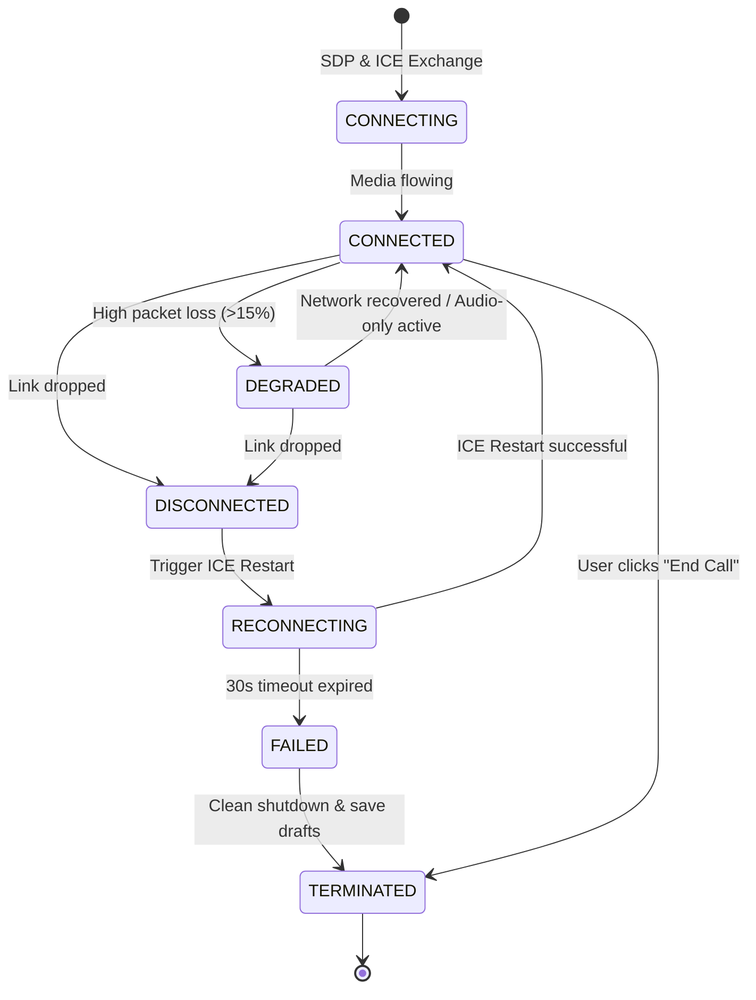

# Swasthya Setu — WebRTC Telemedicine Communication Design

**Document:** `architecture/webrtc-design.md`  
**Project:** Swasthya Setu — Low-Network Telemedicine  
**Track:** Innovate Odisha 3.0  
**Role:** Senior Software Architect & Healthcare Technology Engineer  
**Status:** Approved Architectural Blueprint  
**Version:** 1.0  

---

This document specifies the real-time audio/video communication architecture for Swasthya Setu. It describes peer connection lifecycles, WebSocket-based signaling, STUN/TURN NAT traversal, dynamic bandwidth adaptation from video to audio-only mode, and honest boundary limits during network blackouts.

---

## 1. Architectural Phasing & MVP Strategy

### Implementation Sequence Justification
A common failure in telemedicine hackathons is attempting to build WebRTC video calling before the underlying patient data and offline synchronization foundations are solid.

In Swasthya Setu, **the offline record and safe synchronization engine is built first (Phases 1–8)**. The WebRTC real-time communication engine is built as a **dedicated second milestone (Phases 9–10)**.

```
[ Phase 1-8: Core Foundation ]
  |-- Offline PWA Shell
  |-- IndexedDB Patient Records
  |-- Consultation Notes & Drafts
  |-- Sync Queue & Idempotency
  |-- Role-Based Authentication
             |
             v
[ Phase 9-10: Real-Time Media ]
  |-- WebSocket Signaling Server
  |-- WebRTC Audio/Video Engine
  |-- Dynamic getStats() Telemetry
  |-- Video-to-Audio Graceful Fallback
  |-- ICE Restart & Reconnection
```

*Rationale:* In rural Odisha, healthcare workers spend substantial time physically traveling between villages where no cellular connection exists. During these periods, offline records and draft notes are indispensable. Video calling is an augmentation used only when connectivity is present; therefore, patient data safety must never depend on real-time calling infrastructure.

---

## 2. Real-Time Architecture Overview

```
+-----------------------------------------------------------------------------------------+
|                                WEBRTC REAL-TIME ARCHITECTURE                            |
+-----------------------------------------------------------------------------------------+

  [ Healthcare Worker Client ]                                  [ Doctor Client ]
  (Mobile Browser / Chrome)                                  (Desktop / Laptop Browser)
              |                                                           |
              | 1. WSS Signaling Handshake                                | 1. WSS Handshake
              +-----------------------------\   /-------------------------+
                                             \ /
                                              v
                              +-------------------------------+
                              | WebSocket Signaling Server    |
                              | (Node.js Express Monolith)    |
                              | - Room Registry               |
                              | - SDP Offer/Answer Relay      |
                              | - ICE Candidate Relay         |
                              +---------------+---------------+
                                              |
               2. Discover Public IP / Port   |  2. Discover Public IP / Port
               +------------------------------+---------------------------+
               |                                                          |
               v                                                          v
    +--------------------+                                     +--------------------+
    | Public STUN Server |                                     | Public STUN Server |
    | stun.l.google.com  |                                     | stun.l.google.com  |
    +--------------------+                                     +--------------------+
               |                                                          |
               | 3. Direct P2P Media Stream (DTLS-SRTP Audio/Video)        |
               <==========================================================>
               |                                                          |
               | 4. Fallback Relay (If Symmetric NAT / CGNAT Blocks P2P)  |
               +------------------------\   /-----------------------------+
                                         \ /
                                          v
                                +-------------------+
                                | TURN Relay Server |
                                | (Coturn/Metered)  |
                                +-------------------+
```

---

## 3. Signaling Protocol Design

The signaling service is implemented directly within the Node.js Express process using the `ws` library on the `/ws/signaling` path.

### 3.1 Signaling Message Schema
All signaling frames are serialized as JSON:
```typescript
interface SignalingMessage {
  type: 'JOIN_ROOM' | 'PEER_JOINED' | 'OFFER' | 'ANSWER' | 'ICE_CANDIDATE' | 'MODE_CHANGE' | 'LEAVE_ROOM';
  roomId: string; // Consultation UUID
  senderRole: 'ASHA' | 'DOCTOR';
  payload?: any;
}
```

### 3.2 Signaling Lifecycle
1. **Join Room:** Both clients establish a WebSocket connection and send:
   `{ type: 'JOIN_ROOM', roomId: 'C-202', senderRole: 'ASHA' }`.
   The server checks the user's session token and verifies that the consultation exists.
2. **Offer / Answer Exchange:**
   - Initiator (Doctor or Worker) creates an SDP offer:
     `const offer = await peerConnection.createOffer();`
     `await peerConnection.setLocalDescription(offer);`
   - Client sends `{ type: 'OFFER', roomId: 'C-202', payload: offer }`.
   - Signaling server relays the payload to the counterpart peer.
   - Remote peer sets `setRemoteDescription`, generates `createAnswer()`, sets `setLocalDescription`, and sends `{ type: 'ANSWER', payload: answer }`.
3. **ICE Candidate Trickle:** As local ICE candidates are gathered by the browser, they are forwarded immediately via `{ type: 'ICE_CANDIDATE', payload: candidate }` and added to the remote peer via `peerConnection.addIceCandidate()`.

---

## 4. NAT Traversal: STUN and TURN Infrastructure

### Why TURN is Non-Negotiable in Rural India
In rural Indian cellular networks (e.g., Reliance Jio, Bharti Airtel, BSNL), mobile devices operate behind **Carrier-Grade NAT (CGNAT)** and symmetric firewall topologies.
* Under symmetric NAT, direct peer-to-peer UDP hole-punching via STUN fails in approximately 60–80% of cross-network sessions.
* **Without a TURN (Traversal Using Relays around NAT) server, teleconsultation calls will simply fail to connect.**

### ICE Configuration
```typescript
export const rtcConfiguration: RTCConfiguration = {
  iceServers: [
    // 1. Primary Public STUN
    { urls: 'stun:stun.l.google.com:19302' },
    // 2. Secondary Backup STUN
    { urls: 'stun:stun1.l.google.com:19302' },
    // 3. Fallback TURN Relay Server
    {
      urls: 'turn:turn.swasthyasetu.org:3478?transport=udp',
      username: 'hackathon_relay_user',
      credential: 'RelayPassword123!'
    },
    // 4. Secure TURN over TLS (port 443 for strict firewall traversal)
    {
      urls: 'turns:turn.swasthyasetu.org:443?transport=tcp',
      username: 'hackathon_relay_user',
      credential: 'RelayPassword123!'
    }
  ],
  iceCandidatePoolSize: 2
};
```

---

## 5. Media Constraints & Adaptive Video-to-Audio Fallback

### 5.1 Initial Media Acquisition
```typescript
const mediaConstraints: MediaStreamConstraints = {
  audio: {
    echoCancellation: true,
    noiseSuppression: true,
    autoGainControl: true
  },
  video: {
    width: { ideal: 640, max: 1280 },
    height: { ideal: 480, max: 720 },
    frameRate: { ideal: 15, max: 24 } // Low framerate saves cellular uplink bandwidth
  }
};
```

### 5.2 Network-Quality Monitoring via `getStats()`
A background interval polls `peerConnection.getStats()` every 2000 ms to measure transport health:

```typescript
interface NetworkQualityMetrics {
  downlinkBitrateKbps: number;
  packetLossPercent: number;
  roundTripTimeMs: number;
  jitterMs: number;
}

export async function sampleNetworkQuality(pc: RTCPeerConnection): Promise<NetworkQualityMetrics> {
  const stats = await pc.getStats();
  let packetsLost = 0;
  let packetsReceived = 0;
  let rtt = 0;
  let jitter = 0;

  stats.forEach(report => {
    if (report.type === 'inbound-rtp' && report.kind === 'video') {
      packetsLost = report.packetsLost || 0;
      packetsReceived = report.packetsReceived || 0;
      jitter = (report.jitter || 0) * 1000;
    }
    if (report.type === 'candidate-pair' && report.state === 'succeeded') {
      rtt = (report.currentRoundTripTime || 0) * 1000;
    }
  });

  const totalPackets = packetsLost + packetsReceived;
  const packetLossPercent = totalPackets > 0 ? (packetsLost / totalPackets) * 100 : 0;

  return { downlinkBitrateKbps: 0, packetLossPercent, roundTripTimeMs: rtt, jitterMs: jitter };
}
```

### 5.3 Automated Fallback State Machine
1. **Trigger Condition:**
   - Packet Loss $> 15\%$ over two consecutive polling windows (4 seconds), OR
   - Round Trip Time $> 600\text{ ms}$, OR
   - User manually clicks **[Switch to Audio Mode]**.
2. **Action:**
   ```typescript
   // Disable local video sender track without tearing down peer connection
   const videoSender = peerConnection.getSenders().find(s => s.track?.kind === 'video');
   if (videoSender && videoSender.track) {
     videoSender.track.enabled = false;
   }
   // Send signaling control notification
   signalingSocket.send(JSON.stringify({
     type: 'MODE_CHANGE',
     roomId,
     payload: { mode: 'AUDIO_ONLY', reason: 'PACKET_LOSS_EXCEEDED' }
   }));
   ```
3. **Recovery Condition:**
   - If packet loss remains $< 5\%$ and RTT $< 250\text{ ms}$ continuously for $> 15$ seconds, the UI surfaces a banner: *"Network has stabilized. [Return to Video Call]"*.

---

## 6. What Can and Cannot Work Offline: The Ground Truth

A core requirement of Swasthya Setu is **absolute honesty** regarding system capabilities.

```
+---------------------------------------------------------------------------------------+
|                                CAPABILITY BOUNDARY TRUTH                              |
+---------------------------------------------------+-----------------------------------+
| Can Function Offline (Without Internet)           | Strictly Impossible Offline       |
+---------------------------------------------------+-----------------------------------+
| 1. Viewing previously downloaded patient records. | 1. Live audio or video calling.   |
| 2. Searching local cached patient index.          | 2. Establishing a WebRTC session. |
| 3. Drafting clinical consultation notes.          | 3. Receiving live remote advice.  |
| 4. Queuing consultation requests for sync.        | 4. Immediate delivery of messages.|
| 5. Reviewing local draft history.                 | 5. Querying un-cached records.    |
+---------------------------------------------------+-----------------------------------+
```

> **Critical Safety Architectural Rule:**  
> A live remote consultation cannot continue normally when all communication paths are unavailable. Switching from video to audio reduces bandwidth consumption from ~500 kbps to ~24 kbps, which helps maintain calls on weak 2G/EDGE signals. However, **audio mode cannot overcome a complete physical loss of cellular signal.**  
> When the network drops to 0 kbps, the system must immediately inform both users that the live call is interrupted, cleanly freeze call timers, preserve drafted notes safely in IndexedDB, and avoid presenting a misleading "Reconnecting..." state indefinitely.

---

## 7. Reconnection Lifecycle & Session Termination



### Handling Abrupt Session Loss
1. If the connection state enters `'disconnected'`, the client starts a 30-second watchdog timer.
2. The media engine triggers `peerConnection.createOffer({ iceRestart: true })`.
3. If reconnection succeeds within 30 seconds, media resumes smoothly.
4. If the timer expires:
   - All local media tracks are stopped: `stream.getTracks().forEach(t => t.stop())`.
   - The camera indicator turns off on the user's device.
   - The UI presents a clear post-call screen: *"Call Interrupted. Your consultation notes have been saved safely in your offline drafts."*
